# Practice Studio

**Your AI coach, right beside your work.**

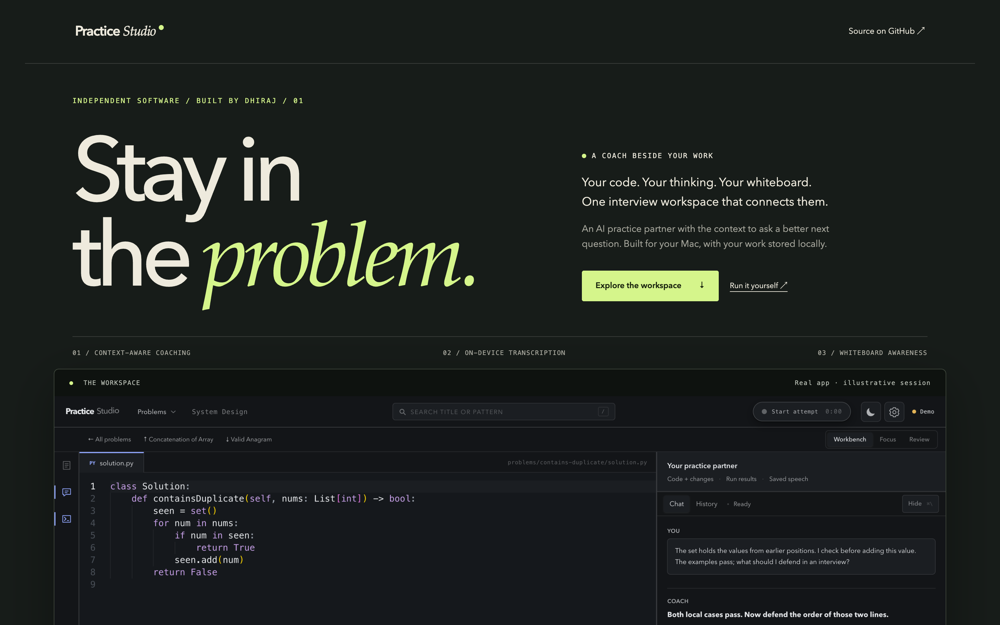

Write code. Run it. Explain your thinking. Draw the architecture. Practice Studio
connects the whole attempt so your AI coach can ask a better next question.

- **Context-aware coaching:** current code, changes, run results, elapsed time, and saved speech.
- **On-device transcription:** dictate a question or think aloud through a recorded attempt.
- **Whiteboard-aware interviews:** Excalidraw components and connections inform the next follow-up.

Runs locally on your Mac, with Claude Code for connected coaching. The coach answers
when you ask or end an attempt for review; recording starts only when you choose it.

[Quick start](#quick-start) · [First session](docs/FIRST-SESSION.md) · [Example session](docs/EXAMPLE-SESSION.md) · [Privacy & offline use](docs/PRIVACY.md)

Run `npm run demo` to start the local showcase server, then open
<http://127.0.0.1:4196/showcase/showcase.html>.

*An illustrative session in the actual app. Code runs locally; the coaching is scripted
for the demo. [See the full example and how the images are made.](docs/EXAMPLE-SESSION.md)*

## The core loop

### Code until the evidence is useful

Browse the NeetCode 250 curriculum, write Python in Monaco, and run example or custom
cases in a fresh local runner. The result is part of the attempt, so the coach can ask
about the invariant you used, the case you missed, or the complexity you can defend.

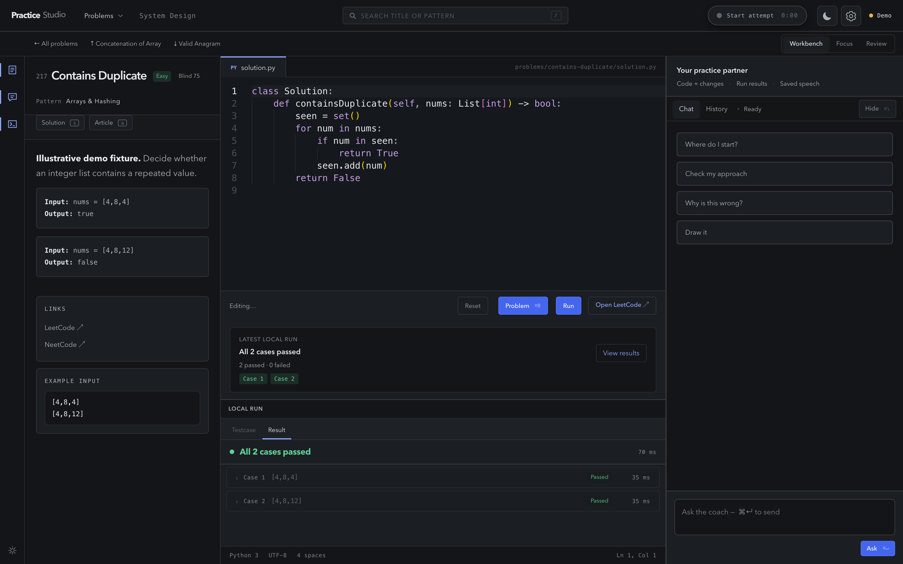

### Browse by pattern, with evidence

The problem explorer groups the catalog by pattern and shows recorded progress beside
each problem. Accepted submissions, locally passed examples, and work in progress remain
separate; a missing record stays “Not started” rather than becoming a guessed statistic.

[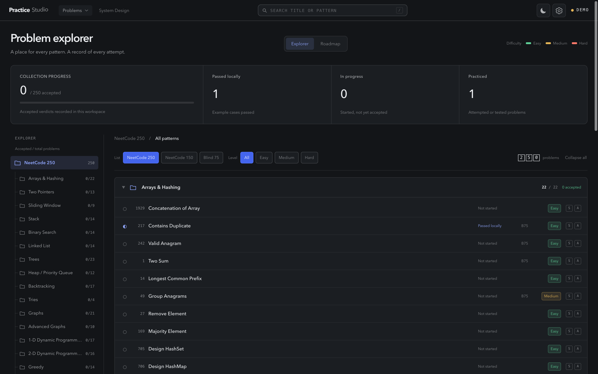](docs/showcase.html#explorer)

Switch to the roadmap to explore suggested study connections between all 18 patterns.
Select a node to see its problems and recorded progress; pan, zoom, or fit the map
without leaving your place. Connections guide study without locking any problem.

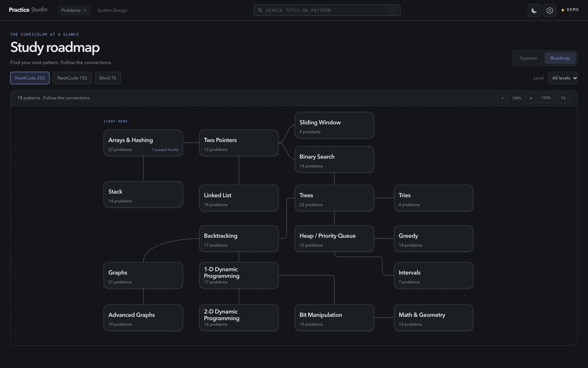

### One workspace, panes on demand

The problem, editor, results and coach share one screen. Show or hide each pane from the
rail on the left or with `⌘B`, `⌘J` and `⌘\`; Studio remembers what you left open.

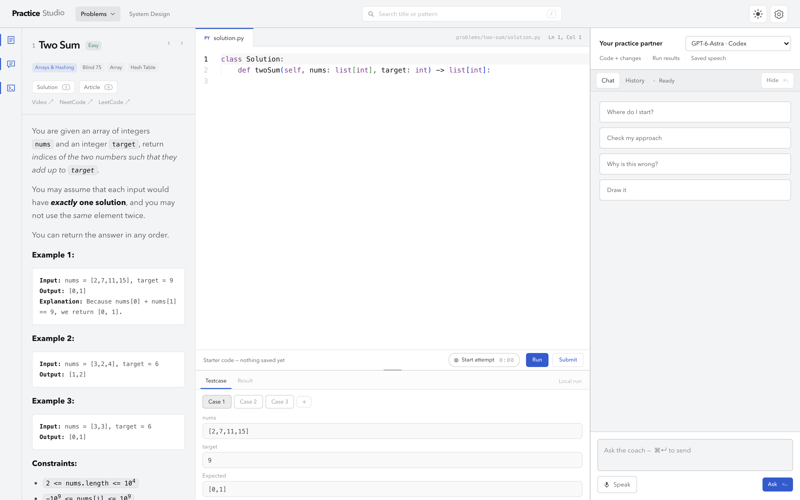

### A coach beside you for the whole attempt

Ask a typed question, dictate a draft, or press Start Attempt and think aloud. The coach
can receive your buffer, code changes, run results, elapsed time, and available
transcripts. It responds to an explicit question or when you end the attempt for review.
Voice mode uses the on-device transcriber after its model is downloaded; spoken responses
use the browser's speech synthesis. [Read the voice setup and boundaries.](docs/SETUP.md#voice-input)

### Hear it become text

Play the synthetic voice sample in the [interactive showcase](docs/showcase.html),
then follow the **actual on-device recognizer’s word timings**. The sample is generated
with macOS speech synthesis and transcribed by Studio’s real Parakeet pipeline—no
personal recording and no cloud speech service.

[Listen to the input](docs/media/reasoning.wav) · [Inspect the transcript and timings](docs/media/reasoning.json)

### Draw the design you would defend

Use the Excalidraw board for a full system-design mock interview. Studio turns labeled
shapes, arrows, and canvas notes into a semantic graph, then includes that graph and its
meaningful changes in the next interviewer turn. The interviewer works from the
board’s semantic data, including missing connections and changes between turns.

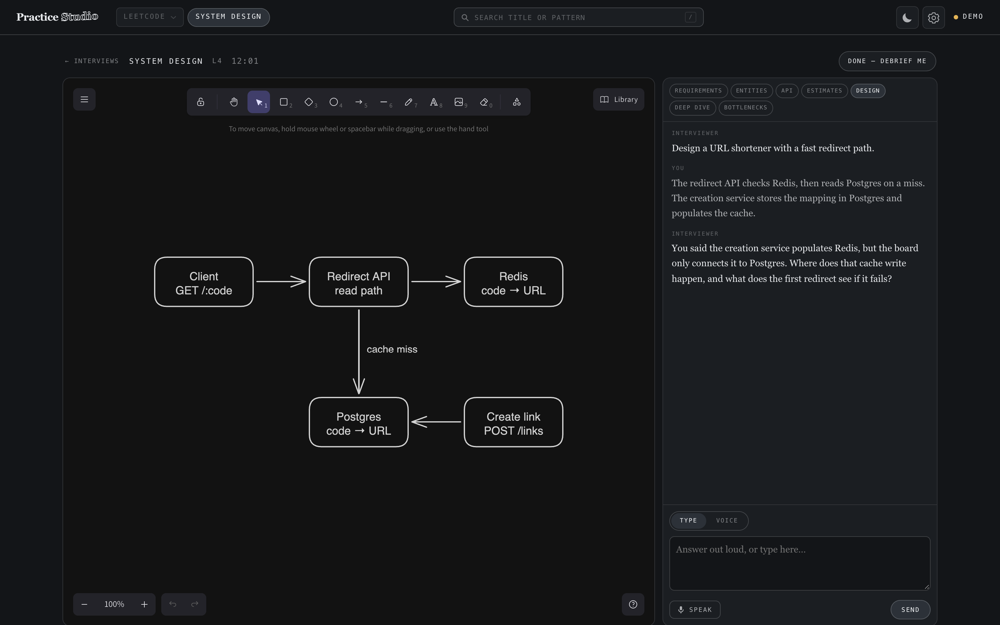

## Five themes, each light and dark

A theme changes the character of the whole app: type, corners, rules and how the panes
sit. Every theme has a light and a dark mode. Choose the theme under **Settings → Theme**
and the mode under **Settings → Appearance** (System, Light or Dark), or flip the mode with
the sun/moon button. Both are stored locally.

<table>
<tr>
<td><a href="docs/images/theme-studio-light.png"></a></td>
<td><a href="docs/images/theme-studio-dark.png">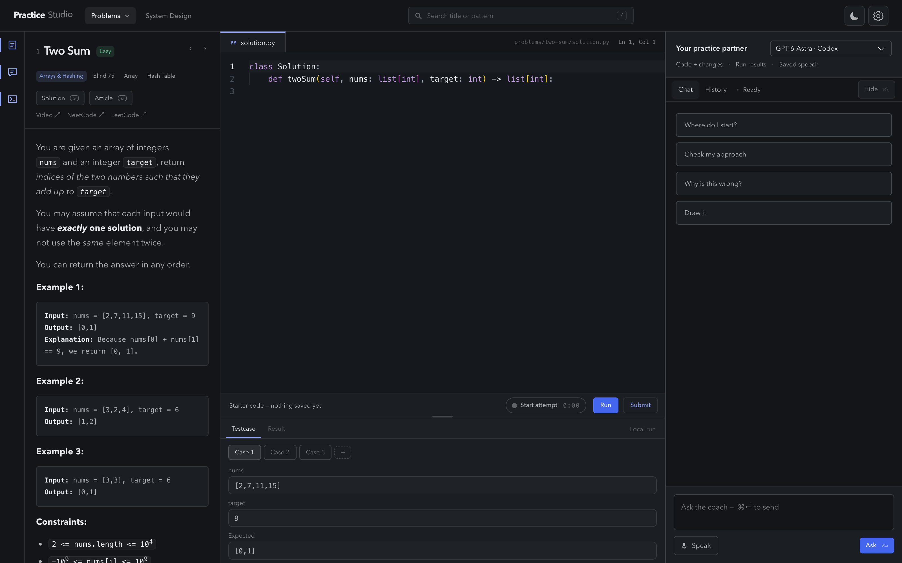</a></td>
</tr>
<tr><td colspan="2"><strong>Studio</strong> · <sub>Clean and docked. Panes meet edge to edge.</sub></td></tr>
<tr>
<td><a href="docs/images/theme-desk-light.png">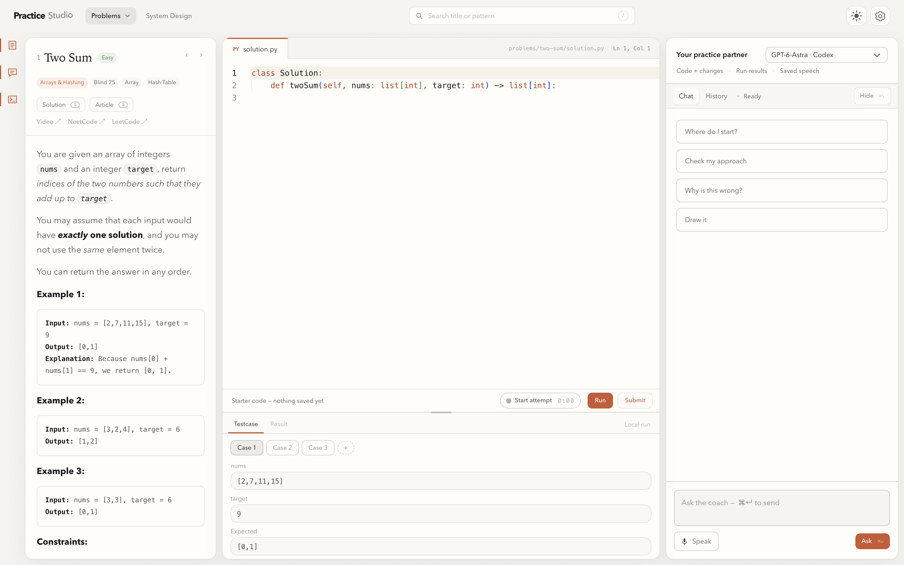</a></td>
<td><a href="docs/images/theme-desk-dark.png">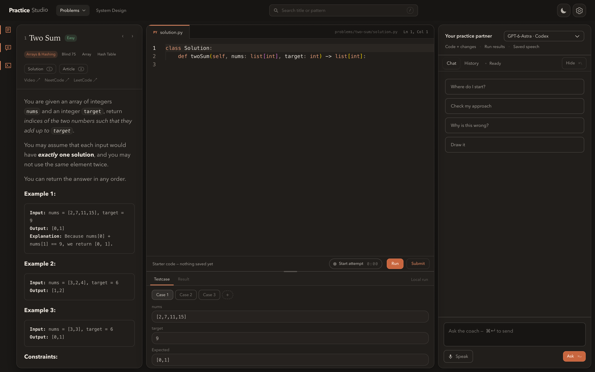</a></td>
</tr>
<tr><td colspan="2"><strong>Desk</strong> · <sub>Soft and rounded. Panes float on warm paper.</sub></td></tr>
<tr>
<td><a href="docs/images/theme-editorial-light.png">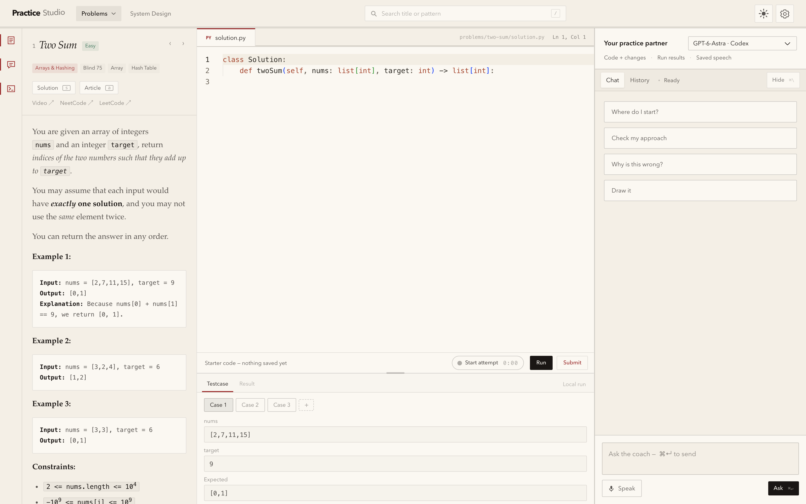</a></td>
<td><a href="docs/images/theme-editorial-dark.png">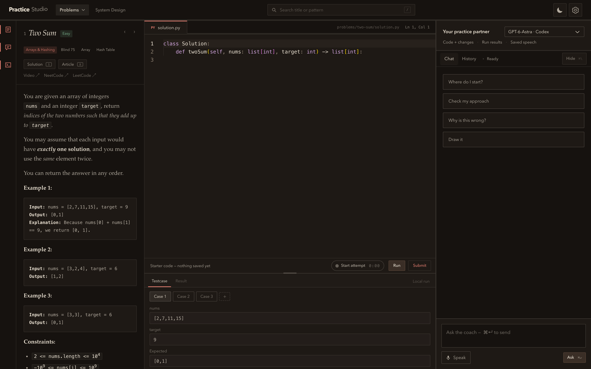</a></td>
</tr>
<tr><td colspan="2"><strong>Editorial</strong> · <sub>Serif prose, double rules, a printed page.</sub></td></tr>
<tr>
<td><a href="docs/images/theme-ink-light.png">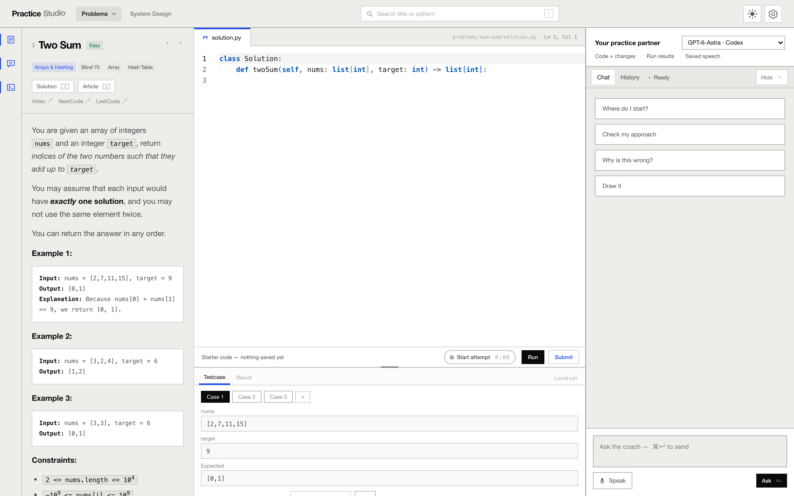</a></td>
<td><a href="docs/images/theme-ink-dark.png">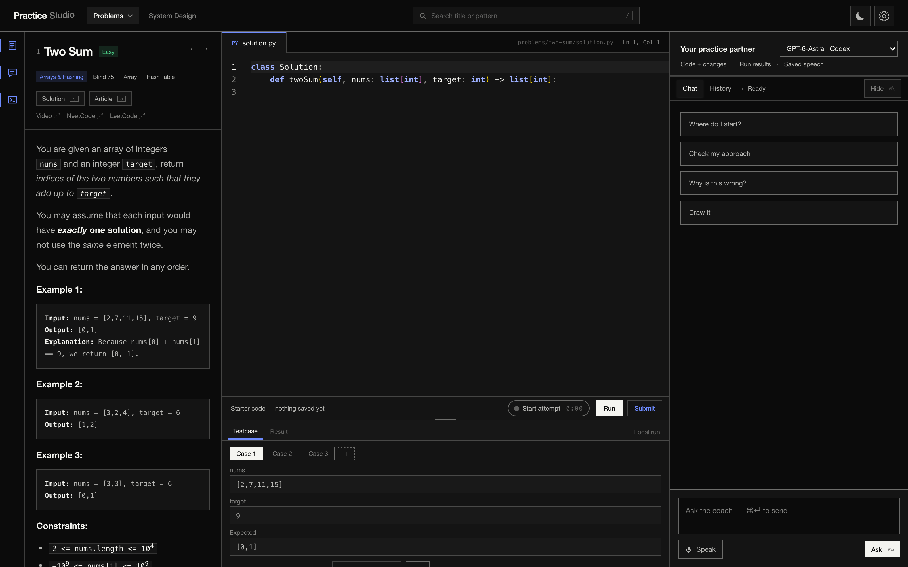</a></td>
</tr>
<tr><td colspan="2"><strong>Ink</strong> · <sub>Hard edges, heavy rules, no rounding.</sub></td></tr>
<tr>
<td><a href="docs/images/theme-terminal-light.png">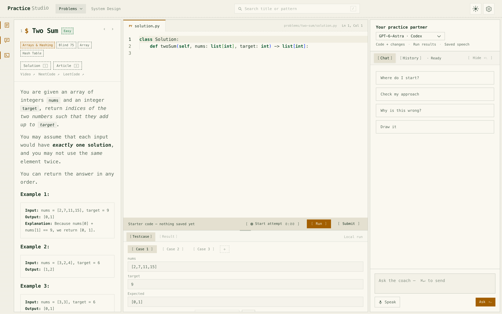</a></td>
<td><a href="docs/images/theme-terminal-dark.png">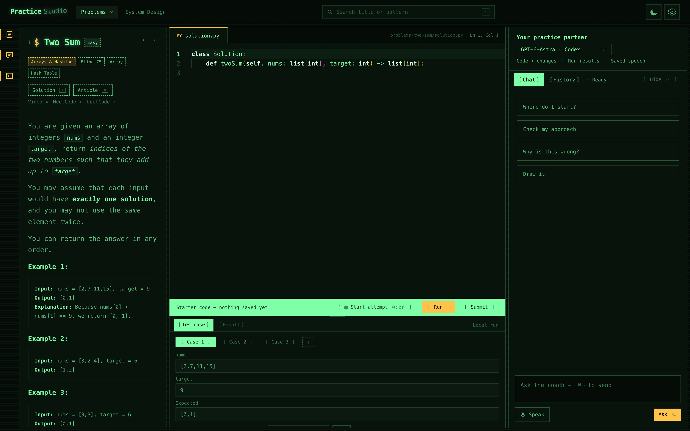</a></td>
</tr>
<tr><td colspan="2"><strong>Terminal</strong> · <sub>Monospaced everything. A command log.</sub></td></tr>
</table>

## Quick start

**Requirements:** macOS, Node.js 22+, and Python 3. The editor and local runner work
without Claude Code. Voice additionally requires macOS 14+, Swift 6, and the downloaded
speech model.

```sh
git clone https://github.com/dhirajcdry/practice-studio.git
cd practice-studio
npm start
```

Open **http://127.0.0.1:4173**. There is no npm install or frontend build step. Search
for a problem, open it while online to cache its statement and starter code, then write
your solution and press **Run**. Local results cover the cases shown; they are separate
from an accepted LeetCode submission.

| Optional piece | Setup |
| --- | --- |
| AI coach and system-design interviewer | Install and sign in to the Claude Code CLI; `claude` must be on your `PATH`. Coaching uses its configured online service. |
| Voice input | Run `swift build -c release --package-path asr`. The first transcription downloads the model; allow microphone access in your browser. |
| Reference solutions and articles | `git clone --depth 1 https://github.com/neetcode-gh/leetcode.git vendor/neetcode-solutions` |
| LeetCode submissions | Load the bundled `extension/` in your browser, signed in to LeetCode. No cookies to copy. [Submitting to LeetCode](docs/SUBMITTING.md). |

[First session](docs/FIRST-SESSION.md) walks through the screens and expected results.
[Setup & troubleshooting](docs/SETUP.md) covers optional features, environment
variables, and keyboard shortcuts.

## Local storage, connected coaching

The browser talks to a Node server bound to `127.0.0.1`. Solutions, logs, transcripts,
and notes are stored in `~/LeetCodeTutor/` (configurable with `STUDIO_HOME`). Monaco and
Excalidraw are bundled in the repository.

Cached problems and the Python runner work offline. Claude coaching needs connectivity
and sends session context to its configured service. Fetching new problem statements and
submitting solutions contact LeetCode. Speech recognition runs on-device after its model
is downloaded. [Privacy & offline use](docs/PRIVACY.md) explains the boundary in full.

## Project notes

[Architecture](docs/ARCHITECTURE.md) explains the processes, storage, and boundaries.
[Engineering decisions](docs/ENGINEERING.md) links the implementation and tests behind
them. [Current limitations](docs/LIMITATIONS.md) · [Roadmap](docs/ROADMAP.md) ·
[Contributing](CONTRIBUTING.md).

## Development

Clone the optional reference repository above before running the full test suite:

```sh
npm test           # Node unit and integration tests; fake coach and judge
npm run check      # Chrome checks; see CONTRIBUTING.md for scratch-workspace setup
```

| Directory | Purpose |
| --- | --- |
| `server/` | Routes, Python runner, coach, judge client, attempt records, and stats |
| `web/` | Browser UI and committed Monaco/Excalidraw assets |
| `asr/` | Optional Swift/CoreML speech recognizer |
| `data/` | Generated curriculum and reference index |
| `scripts/` | Generators, browser checks, and reproducible demo capture |
| `docs/` | User guides, architecture, API contracts, and protocol research |

Working with a coding agent? Start with [AGENTS.md](AGENTS.md).

## Credits & license

Curriculum and list membership come from [NeetCode](https://neetcode.io); optional
reference solutions and articles from [neetcode-gh/leetcode](https://github.com/neetcode-gh/leetcode)
(MIT). LeetCode problem statements are fetched into your local cache and aren't
distributed with this repository. Demo statements are original illustrative fixtures.

Built with [Monaco Editor](https://github.com/microsoft/monaco-editor),
[Excalidraw](https://github.com/excalidraw/excalidraw), and
[FluidAudio](https://github.com/FluidInference/FluidAudio).

[MIT license](LICENSE).

### Choose the coach

Use **Coach model** in the coach header or **Settings → Coach** to choose Codex CLI
or Claude Code. The choice also applies to system-design interviews and persists in
your local workspace. Codex defaults to Astra (`gpt-6-astra`) and uses `codex login`
with ChatGPT; Claude uses its own CLI sign-in. Each provider's limits still apply.
Codex preserves chat history and reads supplied notes; automatic note edits are
currently available only through Claude. No API key is required for the Codex path.
