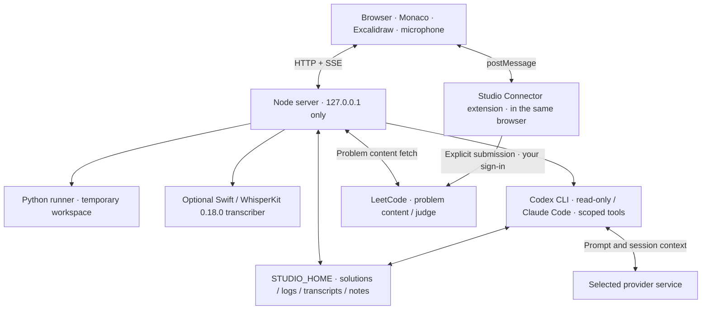

# Practice Studio architecture

This describes the implementation in the repository. The original July 2026 design and
its dated measurements are preserved in [the design archive](archive/ARCHITECTURE-2026-07-25.md);
those measurements aren't current product guarantees.

## Processes and network boundary



The app has a **local Node server**, not a hosted backend. `server/paths.mjs` fixes the
host to `127.0.0.1`; the router checks request `Host`/`Origin`. The browser receives
static files and calls JSON routes. Coaching and interviewing stream events over SSE.
Client files are captured in memory when the server starts (currently about 29 MB,
mostly vendored editors). A running process never serves newly edited UI files against
its older loaded API modules. Restarting Studio publishes the client and backend
together; reload the browser afterward. Containment and symlink checks apply when
capturing the snapshot, and raw learner data is never included in it.

The editor, catalog, and local runner don't wait for a coach turn or judge verdict.
Opening an uncached problem does require a content fetch; cached statements are used
without a request. New AI turns require the CLI's configured online service. Optional
speech-model downloads and reference clones are setup-time network operations. See
[privacy & offline use](PRIVACY.md) for the complete boundary.

## Dependencies

`package.json` has no npm runtime dependencies. HTTP, filesystem, subprocess management,
and streaming use Node built-ins. The frontend is plain browser ES modules, served without
a build step. Monaco and Excalidraw are committed under `web/vendor/`, including fonts and
bundled library code. Excalidraw is loaded when the design view opens.

Python 3 is an external runtime. Claude Code is an optional external executable, with its
own authentication and service. The optional Swift target pins WhisperKit 0.18.0 in
`asr/Package.swift`. It reads the selected `modelName` from the `com.justwisper.app`
UserDefaults domain (default `small.en`), unless `STUDIO_ASR_MODEL` overrides it. Existing
Wispr `Models` and `Tokenizers` are reused read-only; missing models are downloaded under
`~/Library/Application Support/PracticeStudio/ASRModels/`. "No npm runtime
dependencies" doesn't mean the entire system is dependency-free.

## Storage

`STUDIO_HOME` defaults to `~/LeetCodeTutor`. Storage is local, single-server file storage. Canonical records are ordinary files under three track namespaces:

`tracks/<coding|lld|design>/problems/<slug>/` contains the problem workspace. Track
memory is `tracks/<discipline>/MEMORY.md`; migrated hand-written legacy memory is kept
as `tracks/<discipline>/LEGACY.md`. Shared preferences and durable cross-discipline
coaching memory live in `shared/learner.md`; explicit target levels remain in `learner-profile.json`. The resolver in
`server/storage-layout.mjs` supports old `problems/<slug>/` and `memory/*.md` paths
through compatibility aliases/symlinks and rejects ambiguous locations. All archives
are retained losslessly; history scans remain linear and this is not a distributed
storage design.

Important records include:

| Path under the workspace | Role |
| --- | --- |
| `tracks/<discipline>/problems/<slug>/solution.py` | Current working solution; atomically saved by the editor route |
| `tracks/<discipline>/problems/<slug>/attempts/*.py` | Code snapshots from runs |
| `tracks/<discipline>/problems/<slug>/sessions/*.jsonl` | Append-only activity events |
| `tracks/<discipline>/problems/<slug>/chats.jsonl` | Coach conversation record |
| `tracks/<discipline>/problems/<slug>/transcripts/` | Saved coding transcripts and timing metadata |
| `tracks/<discipline>/problems/<slug>/NOTES.md`, `debriefs/` | Coach memory and feedback |
| `tracks/<discipline>/problems/<slug>/attempts/<id>/attempt.md` | Derived readable attempt document |
| `cache/leetcode/<slug>.json` | Cached problem content, metadata, and starter code |
| `cache/neetcode/<ncSlug>.json` | Whitelisted NeetCode problem definition for premium problems, fetched lazily on open |
| `tracks/lld/problems/<lld-slug>/interviews/<id>/code.py`, `interview.json`, `turns.jsonl` | Python LLD document, resumable state, and append-only evidence |
| `tracks/design/problems/<design-slug>/interviews/<id>/` | New system-design state, turns, scene snapshots, follow-ups and derived transcript |
| `tracks/<discipline>/problems/<slug>/NOTES.md`, `LEARNING.md` | Additive learner-saved notes and regenerated assessment summary |
| `tracks/<discipline>/problems/<slug>/problem.json` | Server-owned prepared problem, private facts, curveball and selection provenance |
| `mock-preparations/<discipline>-<request-id>.json` | Idempotent preparation receipt; no running interview or timer |
| `learner-profile.json` | Explicit target-level preferences; performance evidence is derived from records |
| `design/<id>.json` | Locator for a system-design interview stored under its problem folder |
| `design/<id>/interview.json` | Legacy mutable interview state: phase, timing, session identity |
| `design/<id>/turns.jsonl`, `scenes/*.json` | Recorded answers/questions and board snapshots |
| `design/<id>/interview.md` | Derived readable interview document |
| `design/<id>/NOTES.md`, `DESIGN.md` | Design-interview coaching memory |
| `tracks/<discipline>/problems/<slug>/visuals/<id>.png`, `<id>.json` | Coach pictures and what they were drawn from |

Raw activity/turn logs and code/scene snapshots preserve the evidence. Readers tolerate
an invalid final JSONL line from an interrupted write. Rendered documents are rebuilt
from the records, rather than used as new evidence. The browser keeps editor recovery
drafts and preferences in local storage; the CLI also has its own conversation storage.

The canonical problem key is the LeetCode slug. The generated catalog stores a separate
NeetCode slug for upstream articles and list membership. Reference lookup checks both
problem number and compatible slug tokens, because upstream filenames can disagree.

## Coding loop

1. The content cache supplies the Python stub, function/class metadata, example inputs,
   and statement. A missing statement is fetched lazily and then cached.
2. The editor saves the buffer through the workspace route and retains a browser draft.
3. A local run builds cases, snapshots the code, and creates a temporary driver workspace.
4. Python executes the submitted buffer. Results include per-case actual/expected values,
   stdout, timing, and mapped tracebacks.
5. The results panel distinguishes passed, failed, unknown, unsupported, and execution errors.

The runner handles function and supported class-style shapes, trees, lists, linked lists,
and in-place output adapters. Comparison supports float tolerance and selected
order-insensitive cases. Coverage of a recipe or adapter isn't proof of correctness
against hidden tests.

`server/runner/execute.mjs` starts a detached process group, enforces a wall-clock timeout
and output cap, and kills the group on cancellation/timeouts. The Python driver applies
best-effort resource limits and blocks common socket entry points. On macOS,
`sandbox-exec` supplies the OS-level network denial when available and enabled. This
is a practice runner for your own code; the sandbox isn't a general filesystem isolation
boundary. Vendored reference solutions are never run as the expected-answer oracle.

## Coaching

`server/coach/context.mjs` assembles a turn from the current editor buffer, available code
diff, local run evidence, timing, recent activity, and speech transcripts. User and
third-party material is labelled untrusted and fenced with a fresh random marker.
That framing helps the model interpret data; permission scoping is a separate boundary.

`server/coach/claude-cli.mjs` spawns the CLI with manual permissions, restricted tools,
strict MCP configuration, workspace path rules, and explicit denies for working code and
server-owned evidence. Live coaching turns disable native file/shell tools and use only Studio’s named tools.
Claude hooks, auto-memory, discovered instruction files, and slash commands are disabled
for these turns. Legacy file permissions remain in the wrapper for compatibility; they
do not grant live turns arbitrary file access.

Interactive turns resume a native conversation through `server/coach/native-sessions.mjs`.
Studio logical identities remain distinct from native IDs. New/provider-switched segments
bootstrap from saved evidence; subsequent turns append current messages and acknowledged
context changes. Native compaction triggers a full current-state resync. Three-day idle
expiry archives the segment without deleting evidence. See
[NATIVE-CONVERSATIONS.md](NATIVE-CONVERSATIONS.md) for the canonical lifecycle contract.
Both providers report actual usage where available, including cache counts; telemetry in
`usage/turns.jsonl` contains no prompts. Tools page memory and evidence; omission from a
handoff excerpt never means absence from the saved record.

The turn registry keeps a streaming turn separate from the viewer's HTTP connection.
Reloading a tab can reattach rather than launch a duplicate turn. Failed and interrupted
turns are recorded as such. Ending an attempt requests a review of the available evidence;
its judgment is advisory.

## Coding interviews

The problem sidebar stays mounted with Chat, Interviews, and Submissions tabs.
`web/js/interviews.js` owns the interview list and one expanded row; `interview.js`
owns that row's transcript, draft, voice input, and session controls. Browser storage
remembers the selected tab and expanded interview per problem. Server records own
interview identity, timing, feedback, and the append-only transcript. Chat history
contains chat threads only. Interview controls live in the sidebar, not the editor
bar; the legacy recorder remains available there for already-recorded attempts.
`web/css/sidebar.css` owns shared header and record-card geometry. Record summaries
use bounded card surfaces rather than the negative-margin `hover-surface` style;
expanded interview content shares the summary's outer border and horizontal edges.
The interview list owns scrolling, including expanded transcripts and feedback;
embedded cards grow with their content instead of introducing a second scroll box.
New replies follow the active card only when the reader is already at its end.
Background status updates reconcile existing rows without detaching the active panel.

Opening a saved interview is read-only. Resume explicitly continues an unfinished
session; starting fresh creates a separate record and pauses other running interviews.
A completed row opens with saved feedback and a collapsible conversation transcript.
Switching tabs retains the mounted row and draft, and closes its microphone. Typed
interviews do not implicitly enable recording. Only explicit Pause freezes the clock.
Loading a transcript waits for any in-flight server turn before replaying it, and
disables mutations until the read finishes.

Short interviewer replies are buffered for filler classification. Debriefs stream
through the same tag and narration guards as they arrive. Failed or stopped replies
retain their guarded text as explicitly partial evidence. An empty or stopped debrief
does not complete the interview. `POST /api/interview/retry` uses the original saved
request identity and answer, including failed openings, so retries do not add another
candidate turn. Request identities cannot be reused for a different action.

Regression coverage: `server/interview/routes.test.mjs` and `npm run check:interview`
use fake providers and scratch workspaces, including history inspection, selected-row
restoration, paused drafts, fresh sessions, and interrupted-debrief recovery.

## System-design interviews

`server/design/interview.mjs` tracks phase, elapsed time, follow-up depth, and curveball
state. Every native turn is fresh and rehydrates explicit history; saved records preserve
exact `said`/`asked` events. A fresh debrief includes original requirements, full final
code, selected chronological code deltas and assistance, with a larger budget. Memory is
written through Studio tools in the same turn; there is no automatic extra upkeep call.

The browser saves scene changes separately from answers. Posting a scene doesn't wake
the model. On the candidate's next answer, `sceneToGraph()` extracts labelled components
and connections, and the turn context includes a graph diff. Freehand nuance and unlabeled
shapes may be lost in this representation.

The narration filter and phase-tag stripper hold back incomplete patterns while tokens
arrive. This lets them cut a reply that begins impersonating the candidate before the
full forbidden label reaches the viewer or speech output. The recorded turn indicates
when the guard interrupted a response.

Typed and voice answers are separate modes. The optional Swift transcriber handles audio
locally; browser `speechSynthesis` reads interviewer replies. Leaving the view pauses its
clock. The library supports resuming unfinished interviews and reading completed records.

## Real judge

Submissions go through the browser, not the server. The Studio Connector extension
(`extension/`) sends one submission per explicit click from a leetcode.com tab, using the
browser's own LeetCode sign-in, then polls that submission's result. The page passes the
submission id and LeetCode's raw result to `POST /api/submit/record`; the server builds the
verdict (acceptance is `status_code === 10`) and records the code, session events and
`meta.json`. The server holds no LeetCode credentials and never contacts the judge.
Polling reads the result of that submission; nothing creates a second one. Every failure
says whether the code reached LeetCode. Full design: [Submitting to LeetCode](SUBMITTING.md).

Submission history is read from `GET /api/problems/:slug/submissions`; code is returned
only from the problem's own submissions directory. Optional judge details are attached
once through `POST /api/problems/:slug/submissions/:id/details` and stored as an atomic
JSON sidecar beside the submitted code. The Connector performs one optional details read after judging and never retries it.
`GET /api/problems/:slug/history` returns threads only. Sidecars carry schemaVersion 1,
submissionId, source, at, verdict, failure, details and leadUp. `get_submissions` is a
read-only Studio tool for both coach providers; validated message attachments include
the saved code and diffs as fenced data.

## Validation and further reading

`npm test` runs Node unit/integration tests with local fixtures and fake CLI/judge responses.
The CI workflow runs that suite on macOS. Browser checks measure real Chrome layout and
exercise rendering, shortcuts, streaming, and the Excalidraw bundle. They have additional
setup requirements described in [contributing](../CONTRIBUTING.md).

- [Engineering decisions and test locations](ENGINEERING.md)
- [API contract](API-CONTRACT.md) and [coding/coach additions](API-CONTRACT-P2.md)
- [Submitting to LeetCode](SUBMITTING.md)
- [Dated LeetCode protocol research](LEETCODE-API.md)
- [Privacy & offline use](PRIVACY.md)

## Live dictation

Coding chat, mock interviews and practice share a live voice panel. Confirmed draft
text stays separate from highlighted provisional words. The microphone requests a
cumulative phrase snapshot about every 900 ms, with at most one preview in flight.
The native preview decoder uses no temperature fallback, a 128-token sampling limit,
and no word timestamps; the final pass retains full decoding. Final requests take
priority over queued previews. Phrase sequence and microphone-take generation guard
preview results: a phrase boundary keeps its pending preview alive until final decoding
returns, while completed phrases and old takes reject stale results. Previews from
multiple pending phrases appear in recording order and never become saved evidence.
The final phrase is drained before Ask becomes available again. Phrases require sustained
voiced duration and RMS energy before preview or final transcription; Stop uses the same
gate. Audio-meter failure releases the microphone and asks the user to try again. Shared
transcript filtering removes sound annotations and short known Whisper hallucinations.
Coding interviews also reject noise at the server boundary, recording a skipped-noise
event without a candidate turn or model call. Filler-only interviewer replies are suppressed
before any text or speech is emitted.

`studio-asr --worker` retains one loaded WhisperKit model and processes newline-delimited
requests sequentially. The server restarts a failed worker for subsequent queued requests;
individual failures remain visible. All recognition stays local. Dictation audio files
are temporary and removed after processing, and dictation transcripts are excluded from
practice evidence. The original `--input` command remains available for file transcription.

Regression checks: `server/asr/voice-control.test.mjs` covers previews, finalization,
late results, missing metering and notices; `server/asr/worker.test.mjs` covers worker
reuse, priority, cancellation, crashes, timeouts and cleanup. Failed final phrases
retain temporary audio in the mounted browser control for explicit retry/discard,
block later phrase emission to preserve order, and prevent incomplete submission.
The shared voice panel offers last accepted answer, manual/pause-to-send policy,
real input level history and playback captions. The speech queue distinguishes
preparation from actual playback, prefetches a sentence, supports interruption and
replay, and labels system fallback. `speech-stream.js` feeds practice and both mock
interfaces incrementally: complete sentences immediately, or stable short clauses after
a 320 ms budget. Incomplete words, Markdown, links, and code are held or omitted. Each
reply owns a cancellable stream so interruption cannot resume audio on later tokens.

Practice's `voice-loop.js` separates continuous conversation intent from individual
microphone takes. Capture waits for transcription, generation and playback, then resumes;
an interrupted reply permits capture while its remaining text arrives. Explicit pause,
mode change, focus/visibility and device failures gate the loop. Voice warmup only checks
local availability when the learner joins, with no installation or model-generated turn.
`npm run check:voice` exercises real browser capture/ASR flows with synthetic audio,
holds SSE open until actual playback starts, and checks automatic second turns,
interruption, mode switches and delayed previews after phrase boundaries,
while visual-audit voice states cover all themes without running a real model.

## Coach visuals

The coach can answer with fenced blocks the browser draws. ````viz` is a JSON spec of an
exact illustration (graph, array, grid, tree, list, stack, queue, panels, with optional
step frames), drawn instantly by `web/js/viz.js`. ````mermaid` is a plain flowchart.
The prompt section that teaches the coach these lives in `server/coach/context.mjs` and
goes into normal and review turns alike.

````image` carries `{prompt, alt}` for a picture made by Codex's image model.
`server/coach/visuals.mjs` draws it in its own Codex app-server with a separate, ephemeral read-only thread, approvals never, temporary working
directory, no `OPENAI_API_KEY`, every MCP server disabled by name, every server-to-client
request refused. Only `image_generation` is enabled, and only there. The description is
fenced as data, and the bytes are accepted only as PNG, JPEG or WebP by magic number, up
to 15 MB.

A picture's id is the first 20 hex characters of `sha256(slug + "\n" + trimmed prompt)`,
so a replayed reply finds the picture it already has. It is stored as
`problems/<slug>/visuals/<id>.<ext>` plus a `<id>.json` meta, written atomically, meta
last. One picture is drawn at a time across the server; up to four wait, and more are
turned away without being remembered as failures. Failures are held in memory only, and
are not retried until the browser asks with `retry: true`. A GET never starts work.

## Coach providers and model selection

The coach header and Settings share a model picker backed by `GET /api/coach/models`
and `PUT /api/coach/model`. The selection is saved atomically in
`STUDIO_HOME/coach-settings.json`; it applies to subsequent coding and system-design
turns. The default is Codex CLI with `gpt-6-astra`. Claude Code default, Sonnet, Opus,
and Haiku remain explicit choices. No automatic provider or API-billing fallback occurs.
The Codex catalog comes from `model/list`; catalog membership does not guarantee quota
or entitlement, so inference errors remain visible.

`server/coach/provider.mjs` dispatches a snapshotted provider/model choice. Claude retains
its existing scoped tool permissions. Codex uses the installed CLI's ChatGPT sign-in via
app-server stdio, with a temporary working directory and persisted read-only thread.
Shell/apps/plugins/image generation are disabled. Only Studio dynamic tools and explicitly
authorized native web research are available. The child environment excludes `OPENAI_API_KEY`. No credentials are returned to
the browser.

MCP servers from the user's own `~/.codex/config.toml` are turned off by name on every
start and resume. `mcp_servers: {}` on `thread/start`, and `-c mcp_servers={}` on the command line,
are merged into that config rather than replacing it, so a browser server with unsafe code
execution auto-approved still started inside Studio's threads. Studio now lists the
configured servers with `mcpServerStatus/list` (which does not start them) and passes
`{ <name>: { enabled: false } }` for each. If the list cannot be read, or a server reports
starting anyway, the turn fails closed and the process is stopped.
The protocol follows the [Codex app-server documentation](https://learn.chatgpt.com/docs/app-server).

Codex receives saved history on bootstrap, acknowledged context changes on resume and scoped memory, with
reference data fenced separately from instructions. It can maintain scoped memory through Studio tools; Studio
still saves its chats and interview outcomes. Both providers update scoped memory through Studio tools.
Native Claude session IDs are never passed to Codex as native thread IDs. Switching back
to Claude reconstructs context before starting a new native session. Provider/model
metadata is additive; untagged older records are treated as Claude. Existing learner
records are not rewritten.

Use `codex login` or the normal Claude Code sign-in for the selected provider. The model
picker does not claim to bypass either provider's subscription limits. Provider, routing,
context-switching, lifecycle, and permission regressions are under `server/coach/test/`.


## Practice branches and local storage

`STUDIO_HOME` is the local data root (default `~/LeetCodeTutor`, configurable at
launch). Each topic owns `problems/<slug>/interviews/<mock-id>/` and
`problems/<slug>/practice/<practice-id>/`. Existing system-design records under
`design/<mock-id>/` remain readable; newer design records use a small
`design/<mock-id>.json` topic locator. Branching never migrates an original.

A practice directory contains `session.json` (identity, mode, dates, typed source
provenance), `document.json` or `elements.json` (editable work), `exchanges.json`
(questions, answers and request snapshots), and `runs.jsonl` (execution evidence).
A branch also has immutable `source.json`: source identity, original problem,
starting work, compact conversation and model feedback. Source run history and all
prior code/scene snapshots stay in the mock folder; they are not recursively copied.
Problem-level `NOTES.md` contains saved learning notes; `LEARNING.md` is derived
from interviews. Practice remains ungraded and does not create another mock verdict.

Creation stages all initial files in a hidden sibling directory and renames it into
place only when complete. Autosaves use atomic file replacement and a per-session
in-process queue. Questions are recorded before generation and retry identities
reuse the original question evidence. These protect normal operation in the single
local Node server; they are not multi-process database transactions or a backup.

The per-problem layout keeps records portable and independent. Current list/profile
queries still scan files and load histories; some histories are whole JSON documents.
Their work grows with accumulated sessions, so this is a personal local workspace,
not an unbounded multi-user storage design. The scaling path is a rebuildable indexed
metadata store (for example SQLite), paginated history reads and bounded transcript
reads, while retaining these files as the source of truth. No automatic deletion or
rotation of interview evidence is used to hide that cost.


### Shared agent actions across workspaces

`server/coach/tools.mjs` remains the common tool contract/executor. The workspace
factory selects coding, Python-document, whiteboard, or finished-review abilities
for both Codex dynamic tools and Claude's per-turn MCP bridge. Reused Codex mock
threads dispatch to the current turn's ToolSession, with native tools and user MCP
servers still disabled. Turning off editing for a finished report is server-enforced.

Browser actions carry a target containing the practice/mock identity. Code uses exact
unique replacements and the shared editor's undo history; board changes compare a
SHA-256 revision before applying through Excalidraw's undo history. Each application
awaits its normal save path before acknowledgement. Failed acknowledgements are not
successful edits. Actions have persisted pending and final receipts; reopening a
record displays those receipts without replaying mutations. Practice stores receipts
in its exchange; mocks append `tool_action` records. Coach Python execution is
`coach_run` evidence, separate from candidate runs. The debrief must distinguish
assisted contributions from unaided performance.

Durable agent memory lives in `tracks/<discipline>/problems/<slug>/NOTES.md` and
`tracks/<discipline>/MEMORY.md` and `shared/learner.md`. Tools read named scopes, append a dated problem
note, or replace one unique exact passage. Updates are atomic and share a per-file
write lock with other note tools, user note saves and legacy Claude upkeep. These
files feed subsequent chat/mock/practice turns and adaptive problem selection;
recorded assessments remain evidence sources, not editable memory. Files are bounded
and prompts carry bounded context. This is local single-server storage, not a
multi-process database or a claim of unlimited scalability.
