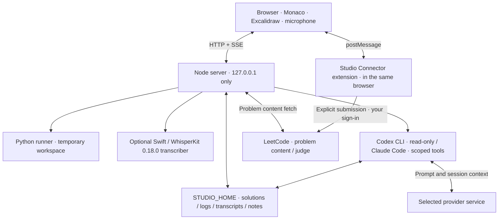

# Practice Studio architecture

This describes the implementation in the repository. The original July 2026 design and
its dated measurements are preserved in [the design archive](archive/ARCHITECTURE-2026-07-25.md);
those measurements aren't current product guarantees.

## Processes and network boundary



The app has a **local Node server**, not a hosted backend. `server/paths.mjs` fixes the
host to `127.0.0.1`; the router checks request `Host`/`Origin`. The browser receives
static files and calls JSON routes. Coaching and interviewing stream events over SSE.

The editor, catalog, and local runner don't wait for a coach turn or judge verdict.
Opening an uncached problem does require a content fetch; cached statements are used
without a request. New AI turns require the CLI's configured online service. Optional
speech-model downloads and reference clones are setup-time network operations. See
[privacy & offline use](PRIVACY.md) for the complete boundary.

## Dependencies

`package.json` has no npm runtime dependencies. HTTP, filesystem, subprocess management,
and streaming use Node built-ins. The frontend is plain browser ES modules, served without
a build step. Monaco and Excalidraw are committed under `web/vendor/`, including fonts and
bundled library code. Excalidraw is loaded when the design view opens.

Python 3 is an external runtime. Claude Code is an optional external executable, with its
own authentication and service. The optional Swift target pins WhisperKit 0.18.0 in
`asr/Package.swift`. It reads the selected `modelName` from the `com.justwisper.app`
UserDefaults domain (default `small.en`), unless `STUDIO_ASR_MODEL` overrides it. Existing
Wispr `Models` and `Tokenizers` are reused read-only; missing models are downloaded under
`~/Library/Application Support/PracticeStudio/ASRModels/`. "No npm runtime
dependencies" doesn't mean the entire system is dependency-free.

## Storage

`STUDIO_HOME` defaults to `~/LeetCodeTutor`. Important records are ordinary files:

| Path under the workspace | Role |
| --- | --- |
| `problems/<slug>/solution.py` | Current working solution; atomically saved by the editor route |
| `problems/<slug>/attempts/*.py` | Code snapshots from runs |
| `problems/<slug>/sessions/*.jsonl` | Append-only activity events |
| `problems/<slug>/chats.jsonl` | Coach conversation record |
| `problems/<slug>/transcripts/` | Saved coding transcripts and timing metadata |
| `problems/<slug>/NOTES.md`, `debriefs/` | Coach memory and feedback |
| `problems/<slug>/attempts/<id>/attempt.md` | Derived readable attempt document |
| `cache/leetcode/<slug>.json` | Cached problem content, metadata, and starter code |
| `cache/neetcode/<ncSlug>.json` | Whitelisted NeetCode problem definition for premium problems, fetched lazily on open |
| `design/<id>/interview.json` | Mutable interview state: phase, timing, session identity |
| `design/<id>/turns.jsonl`, `scenes/*.json` | Recorded answers/questions and board snapshots |
| `design/<id>/interview.md` | Derived readable interview document |
| `design/<id>/NOTES.md`, `DESIGN.md` | Design-interview coaching memory |
| `problems/<slug>/visuals/<id>.png`, `<id>.json` | Coach pictures and what they were drawn from |

Raw activity/turn logs and code/scene snapshots preserve the evidence. Readers tolerate
an invalid final JSONL line from an interrupted write. Rendered documents are rebuilt
from the records, rather than used as new evidence. The browser keeps editor recovery
drafts and preferences in local storage; the CLI also has its own conversation storage.

The canonical problem key is the LeetCode slug. The generated catalog stores a separate
NeetCode slug for upstream articles and list membership. Reference lookup checks both
problem number and compatible slug tokens, because upstream filenames can disagree.

## Coding loop

1. The content cache supplies the Python stub, function/class metadata, example inputs,
   and statement. A missing statement is fetched lazily and then cached.
2. The editor saves the buffer through the workspace route and retains a browser draft.
3. A local run builds cases, snapshots the code, and creates a temporary driver workspace.
4. Python executes the submitted buffer. Results include per-case actual/expected values,
   stdout, timing, and mapped tracebacks.
5. The results panel distinguishes passed, failed, unknown, unsupported, and execution errors.

The runner handles function and supported class-style shapes, trees, lists, linked lists,
and in-place output adapters. Comparison supports float tolerance and selected
order-insensitive cases. Coverage of a recipe or adapter isn't proof of correctness
against hidden tests.

`server/runner/execute.mjs` starts a detached process group, enforces a wall-clock timeout
and output cap, and kills the group on cancellation/timeouts. The Python driver applies
best-effort resource limits and blocks common socket entry points. On macOS,
`sandbox-exec` supplies the OS-level network denial when available and enabled. This
is a practice runner for your own code; the sandbox isn't a general filesystem isolation
boundary. Vendored reference solutions are never run as the expected-answer oracle.

## Coaching

`server/coach/context.mjs` assembles a turn from the current editor buffer, available code
diff, local run evidence, timing, recent activity, and speech transcripts. User and
third-party material is labelled untrusted and fenced with a fresh random marker.
That framing helps the model interpret data; permission scoping is a separate boundary.

`server/coach/claude-cli.mjs` spawns the CLI with manual permissions, restricted tools,
strict MCP configuration, workspace path rules, and explicit denies for working code and
server-owned evidence. Design notes, coding notes/debriefs, journal, profile, and skill
memory are the writable areas. The CLI can read workspace files, so moving private files
into the workspace makes them available to coaching.

The turn registry keeps a streaming turn separate from the viewer's HTTP connection.
Reloading a tab can reattach rather than launch a duplicate turn. Failed and interrupted
turns are recorded as such. Ending an attempt requests a review of the available evidence;
its judgment is advisory.

## System-design interviews

`server/design/interview.mjs` tracks phase, elapsed time, follow-up depth, and curveball
state. New turns resume the CLI thread when possible; if a saved thread is absent, the
server can rehydrate a fresh prompt from the recorded interview.

The browser saves scene changes separately from answers. Posting a scene doesn't wake
the model. On the candidate's next answer, `sceneToGraph()` extracts labelled components
and connections, and the turn context includes a graph diff. Freehand nuance and unlabeled
shapes may be lost in this representation.

The narration filter and phase-tag stripper hold back incomplete patterns while tokens
arrive. This lets them cut a reply that begins impersonating the candidate before the
full forbidden label reaches the viewer or speech output. The recorded turn indicates
when the guard interrupted a response.

Typed and voice answers are separate modes. The optional Swift transcriber handles audio
locally; browser `speechSynthesis` reads interviewer replies. Leaving the view pauses its
clock. The library supports resuming unfinished interviews and reading completed records.

## Real judge

Submissions go through the browser, not the server. The Studio Connector extension
(`extension/`) sends one submission per explicit click from a leetcode.com tab, using the
browser's own LeetCode sign-in, then polls that submission's result. The page passes the
submission id and LeetCode's raw result to `POST /api/submit/record`; the server builds the
verdict (acceptance is `status_code === 10`) and records the code, session events and
`meta.json`. The server holds no LeetCode credentials and never contacts the judge.
Polling reads the result of that submission; nothing creates a second one. Every failure
says whether the code reached LeetCode. Full design: [Submitting to LeetCode](SUBMITTING.md).

Submission history is read from `GET /api/problems/:slug/submissions`; code is returned
only from the problem's own submissions directory. Optional judge details are attached
once through `POST /api/problems/:slug/submissions/:id/details` and stored as an atomic
JSON sidecar beside the submitted code. The Connector performs one optional details read after judging and never retries it.
`GET /api/problems/:slug/history` returns threads only. Sidecars carry schemaVersion 1,
submissionId, source, at, verdict, failure, details and leadUp. `get_submissions` is a
read-only Studio tool for both coach providers; validated message attachments include
the saved code and diffs as fenced data.

## Validation and further reading

`npm test` runs Node unit/integration tests with local fixtures and fake CLI/judge responses.
The CI workflow runs that suite on macOS. Browser checks measure real Chrome layout and
exercise rendering, shortcuts, streaming, and the Excalidraw bundle. They have additional
setup requirements described in [contributing](../CONTRIBUTING.md).

- [Engineering decisions and test locations](ENGINEERING.md)
- [API contract](API-CONTRACT.md) and [coding/coach additions](API-CONTRACT-P2.md)
- [Submitting to LeetCode](SUBMITTING.md)
- [Dated LeetCode protocol research](LEETCODE-API.md)
- [Privacy & offline use](PRIVACY.md)

## Live dictation

The composer microphone shows a provisional transcript below the draft while speech
continues. It requests a cumulative audio snapshot about every 1.5 seconds, with at most
one preview request in flight and no preview queued behind unfinished final phrases.
Pauses finalize phrases into the editable draft; previews never become saved evidence.
The final phrase is drained before Ask becomes available again. Phrases require sustained
voiced duration and RMS energy before preview or final transcription; Stop uses the same
gate. Audio-meter failure releases the microphone and asks the user to try again. Shared
transcript filtering removes sound annotations and short known Whisper hallucinations.
Coding interviews also reject noise at the server boundary, recording a skipped-noise
event without a candidate turn or model call. Filler-only interviewer replies are suppressed
before any text or speech is emitted.

`studio-asr --worker` retains one loaded WhisperKit model and processes newline-delimited
requests sequentially. The server restarts a failed worker for subsequent queued requests;
individual failures remain visible. All recognition stays local. Dictation audio files
are temporary and removed after processing, and dictation transcripts are excluded from
practice evidence. The original `--input` command remains available for file transcription.

Regression checks: `server/asr/voice-control.test.mjs` covers previews, finalization,
late results, missing metering and notices; `server/asr/worker.test.mjs` covers worker
reuse, ordering, crashes, timeouts and cleanup.

## Coach visuals

The coach can answer with fenced blocks the browser draws. ````viz` is a JSON spec of an
exact illustration (graph, array, grid, tree, list, stack, queue, panels, with optional
step frames), drawn instantly by `web/js/viz.js`. ````mermaid` is a plain flowchart.
The prompt section that teaches the coach these lives in `server/coach/context.mjs` and
goes into normal and review turns alike.

````image` carries `{prompt, alt}` for a picture made by Codex's image model.
`server/coach/visuals.mjs` draws it in its own Codex app-server with the same lockdown as
the chat coach: ephemeral read-only thread, approvals never, temporary working
directory, no `OPENAI_API_KEY`, every MCP server disabled by name, every server-to-client
request refused. Only `image_generation` is enabled, and only there. The description is
fenced as data, and the bytes are accepted only as PNG, JPEG or WebP by magic number, up
to 15 MB.

A picture's id is the first 20 hex characters of `sha256(slug + "\n" + trimmed prompt)`,
so a replayed reply finds the picture it already has. It is stored as
`problems/<slug>/visuals/<id>.<ext>` plus a `<id>.json` meta, written atomically, meta
last. One picture is drawn at a time across the server; up to four wait, and more are
turned away without being remembered as failures. Failures are held in memory only, and
are not retried until the browser asks with `retry: true`. A GET never starts work.

## Coach providers and model selection

The coach header and Settings share a model picker backed by `GET /api/coach/models`
and `PUT /api/coach/model`. The selection is saved atomically in
`STUDIO_HOME/coach-settings.json`; it applies to subsequent coding and system-design
turns. The default is Codex CLI with `gpt-6-astra`. Claude Code default, Sonnet, Opus,
and Haiku remain explicit choices. No automatic provider or API-billing fallback occurs.
The Codex catalog comes from `model/list`; catalog membership does not guarantee quota
or entitlement, so inference errors remain visible.

`server/coach/provider.mjs` dispatches a snapshotted provider/model choice. Claude retains
its existing scoped tool permissions. Codex uses the installed CLI's ChatGPT sign-in via
app-server stdio, with a temporary working directory, an ephemeral read-only thread,
web/shell/apps/plugins/image generation disabled, and every interactive tool request
rejected. The child environment excludes `OPENAI_API_KEY`. No credentials are returned to
the browser.

MCP servers from the user's own `~/.codex/config.toml` are turned off by name on every
thread. `mcp_servers: {}` on `thread/start`, and `-c mcp_servers={}` on the command line,
are merged into that config rather than replacing it, so a browser server with unsafe code
execution auto-approved still started inside Studio's threads. Studio now lists the
configured servers with `mcpServerStatus/list` (which does not start them) and passes
`{ <name>: { enabled: false } }` for each. If the list cannot be read, or a server reports
starting anyway, the turn fails closed and the process is stopped.
The protocol follows the [Codex app-server documentation](https://learn.chatgpt.com/docs/app-server).

Codex receives bounded conversation history and server-read TUTOR/NOTES excerpts, with
reference data fenced separately from instructions. It cannot edit memory files; Studio
still saves its chats and interview outcomes. Automatic note edits remain Claude-only.
Native Claude session IDs are never passed to Codex as native thread IDs. Switching back
to Claude reconstructs context before starting a new native session. Provider/model
metadata is additive; untagged older records are treated as Claude. Existing learner
records are not rewritten.

Use `codex login` or the normal Claude Code sign-in for the selected provider. The model
picker does not claim to bypass either provider's subscription limits. Provider, routing,
context-switching, lifecycle, and permission regressions are under `server/coach/test/`.
