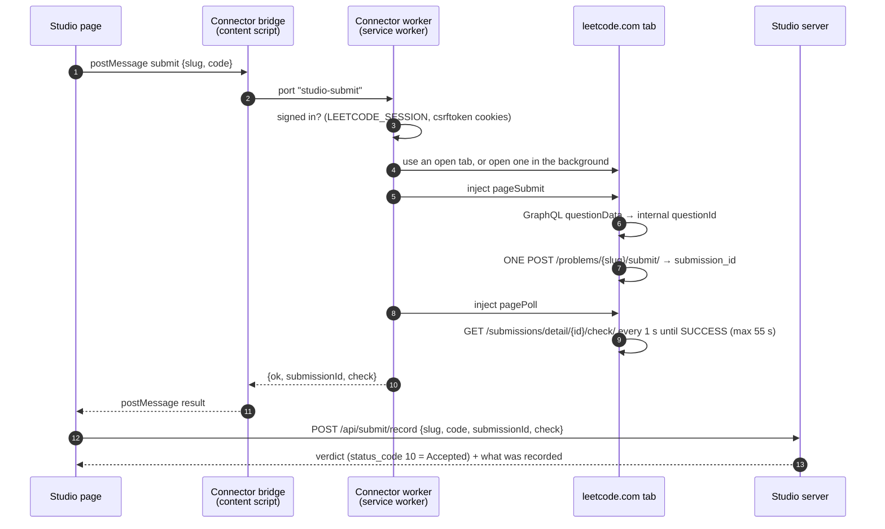

# Submitting to LeetCode

**Run** checks your code locally against the cases you can see. **Submit** sends it to
LeetCode's own judge, which runs every hidden test and returns the verdict that counts.

Studio submits through **your browser**, using a small extension that ships in this repo:
the **Studio Connector** (`extension/`). The extension sends the submission from a
leetcode.com tab, signed in as you, exactly as if you had pressed Submit on LeetCode.
Studio never sees, stores or asks for your LeetCode cookies.

## Set it up once

Use the same browser profile you run Studio in, and make sure you are signed in to
leetcode.com there. Any Chromium browser works: Dia, Chrome, Brave, Arc, Edge.

1. Open `chrome://extensions` (in Dia, `dia://extensions` also works).
2. Turn on **Developer mode** (top right).
3. Click **Load unpacked** and choose this repo's `extension/` folder.
4. Reload Studio.

That's it. There is no command to run, nothing to paste, and no macOS Keychain prompt.
Until the extension is installed, the Submit panel shows these steps along with a
**Copy current solution** button and a link to the problem, so you can still submit by hand.

**After pulling changes to `extension/`**, press the reload icon on the extension's card in
`chrome://extensions`, then reload Studio.

## What happens when you press Submit



1. You click **Submit**. The page asks the Connector, through `window.postMessage`.
2. The Connector checks that this browser is signed in to LeetCode. If not, it stops and
   says so; nothing is sent.
3. It uses an open, loaded leetcode.com tab, or opens the problem page in a background tab
   and closes it afterwards.
4. Inside that tab it looks up the problem's **internal** `questionId` and sends **one**
   POST to `/problems/{slug}/submit/`. Because the request comes from LeetCode's own page,
   it carries your cookies, CSRF token, Cloudflare clearance and the browser's TLS
   fingerprint, which is why Cloudflare lets it through.
5. It polls `/submissions/detail/{id}/check/` once a second until judging finishes, for up
   to 55 seconds.
6. The page sends the submission id and LeetCode's raw result to the Studio server, which
   decides the verdict (Accepted means `status_code === 10`, nothing else) and records it.
7. The panel shows the verdict in LeetCode's own words: the failing input, expected and
   actual output, compile or runtime error, runtime and memory percentiles.

If the server is down at step 6, the panel still shows the verdict, built from the same
result, but it is not saved to your history.

## The rules it never breaks

- **One submission per click.** There is no retry, no backoff loop and no automatic
  resubmission anywhere: not in the page, the extension or the server. A second click on
  the same problem while one is being judged is refused.
- **Honest about what was sent.** Every failure says whether your code reached LeetCode:
  `not_sent`, `submitted` (with a link to the real submission) or `unknown`. Studio never
  offers "Submit again" when the code may already be there.
- **Only Studio can use it.** The bridge only runs on `127.0.0.1` and `localhost`, and only
  answers pages that declare `<meta name="practice-studio">`. The worker rejects
  connections from any other origin.
- **Cookies stay in the browser.** The worker checks that the two LeetCode cookies exist and
  passes the CSRF token into the leetcode.com tab, where LeetCode's own requests use it
  anyway. No cookie value reaches the Studio page, the server, a log or a file.

## What gets recorded

All of it is written by the server into `STUDIO_HOME` (default `~/LeetCodeTutor`):

| Where | What |
| --- | --- |
| `problems/<slug>/submissions/<id>.py` | The exact code that was judged |
| `problems/<slug>/meta.json` → `submissions[]` | Verdict, tests passed, runtime, memory, percentiles, link. Merged into the file, never overwritten; a submission id already there is not added twice |
| `problems/<slug>/sessions/<id>.jsonl` | A `submitted` event and a `verdict` event, which the coach and stats read |

If the code was sent but no verdict came back, only the code and the `submitted` event
are recorded.

## What the panel tells you

| Panel says | Meaning | What to do |
| --- | --- | --- |
| **Install the Studio Connector to submit** | The extension isn't installed in this browser profile, or the page was open before you installed it | Follow [Set it up once](#set-it-up-once), then reload Studio |
| **You are not signed in to LeetCode** | No LeetCode session in this browser profile | Sign in on leetcode.com, then submit again |
| **Your LeetCode session has expired** | LeetCode refused the session the browser has | Sign in again on leetcode.com |
| **The judge could not be reached** (Cloudflare) | Cloudflare wants the browser to verify itself | Open the leetcode.com tab, finish the check, submit again |
| **LeetCode is rate limiting submissions** | Too many submissions in a short window | Wait a minute or two |
| **LeetCode has not finished judging** | Judging took longer than 55 s | Open the linked submission on LeetCode; don't resubmit |
| **A submission is already on its way** | You clicked twice | Wait for the first verdict |

## Troubleshooting

- **The panel still says to install after installing.** Reload the Studio page. The
  extension marks a page as it loads, so pages that were already open don't know about it.
- **"The Studio Connector was reloaded since this page opened."** You reloaded or updated
  the extension. Reload Studio.
- **Studio runs on a different host.** The bridge only matches `http://127.0.0.1/*` and
  `http://localhost/*` (any port). Edit `matches` in `extension/manifest.json` if you need
  another host, then reload the extension.
- **A background tab flashes open and closes.** That's the Connector, when no leetcode.com
  tab was open. Keep one open to avoid it.
- **Want to watch it work?** Open `chrome://extensions`, click **service worker** on the
  Connector's card for its console, or open DevTools on the leetcode.com tab and watch the
  Network panel for `submit/` and `check/`.

## Files

| File | Role |
| --- | --- |
| `extension/manifest.json` | Manifest V3. Permissions: `scripting`, `tabs`, `cookies`; host access to `https://leetcode.com/*` only |
| `extension/bridge.js` | Content script on local pages. Marks the page (`data-studio-connector`), relays one request and one answer |
| `extension/background.js` | Service worker. Sign-in check, tab handling, the in-tab submit and poll, all error wording |
| `web/js/leetcode-bridge.js` | The page side of the message exchange |
| `web/js/api.js` → `submitCode` | Sends to the Connector, then to the record route |
| `web/js/submit.js` | The verdict panel and every state in the table above |
| `server/judge/routes.mjs` | `POST /api/submit/record`: validates and records |
| `server/judge/verdict.mjs` | Turns LeetCode's `/check/` body into the verdict |
| `server/judge/record.mjs` | Writes the code, the session events and `meta.json` |

### Messages

Page → bridge (`window.postMessage`, same origin):

```js
{ source: 'studio-page', type: 'submit', id, slug, code, lang: 'python3' }
```

Bridge → page:

```js
{ source: 'studio-connector', id, result }
// result on success:  { ok: true, submissionId, check }          // check = raw /check/ body
// result on failure:  { ok: false, code, message, submissionState, submissionId?, challenge? }
```

Failure codes: `SIGNED_OUT`, `SESSION_EXPIRED`, `RATE_LIMITED`, `JUDGE_UNREACHABLE`,
`JUDGE_TIMEOUT`, `SUBMIT_IN_FLIGHT`, `PROBLEM_NOT_FOUND`, `BAD_REQUEST`,
`CONNECTOR_ERROR`, `CONNECTOR_GONE`. The page maps them to panel states in `SUBMIT_KINDS`
(`web/js/api.js`); a code it doesn't know still shows the Connector's message verbatim.

`POST /api/submit/record` takes `{ slug, code, submissionId, check }` (`check` is `null` when
no verdict came back). It answers `200` with the verdict payload described in
[API-CONTRACT-P2.md](API-CONTRACT-P2.md#phase-4--the-judge), `400` for a malformed
request or an unfinished `check`, `404` for a slug outside the catalog, and `409` if that
submission was already recorded.

## Developing and testing

- `npm test` covers the record route (`server/judge/test/routes.test.mjs`) and the verdict
  rules (`verdict.test.mjs`). Nothing in the suite talks to LeetCode.
- `web/tests.html` covers every panel state, including the install and sign-in states.
- `?simsubmit=accepted|wrong|tle|compile|runtime|expired|nosession|noconnector|unreachable|judgetimeout|ratelimited|inflight`
  renders a state without touching the extension or LeetCode.
- To exercise the real extension headlessly, use Chrome for Testing or Chromium; branded
  Chrome ignores `--load-extension`. With a fresh profile, a submit through the page
  returns `SIGNED_OUT`, which proves the whole path without sending anything.
- Never automate a real submission. Every one is a real entry on someone's account.

## Why the browser submits, not the server

Studio used to copy the LeetCode cookies into macOS Keychain and submit from its Node
server. Cloudflare recognised that connection as a non-browser client and challenged it
even when the cookies were valid, and copying cookies out of the browser meant repeated
Keychain password prompts. Submitting from a leetcode.com tab removes both problems: the
request is the browser's own, and there is nothing to copy.

The underlying LeetCode endpoints are documented in [LEETCODE-API.md](LEETCODE-API.md)
(Part 2).

## Premium problems

For `isPaidOnly` problems, **Submit on NeetCode ↗** copies the current editor code and
opens the catalog's NeetCode problem page. Paste and submit there manually. If clipboard
access fails, Studio says to copy manually. This path never calls the Studio Connector
or records a LeetCode verdict; **Run** still uses the local runner.

Missing premium statements and Python signatures are fetched lazily from
[doocs/leetcode](https://github.com/doocs/leetcode) (CC BY-SA 4.0), with linked attribution
under the statement. Successful fetches are cached permanently in
`STUDIO_HOME/cache/premium-statements/`; a failed fetch leaves the premium notice.
Only class/method headers and node-definition comments are retained from the Python
solution, with method bodies replaced by `pass`. Existing saved code and recovery drafts
keep precedence. Example outputs are used only when their parsed inputs match all of
LeetCode's supplied example cases; ambiguous formats retain unpublished expectations.
